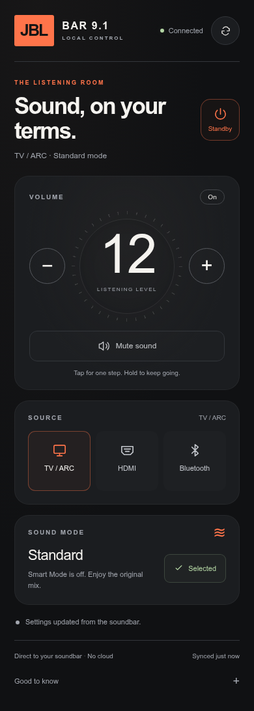

# JBL Bar 9.1 — community tinkering foundation

I started by stopping Smart Mode from coming back whenever I power on my JBL Bar 9.1. I now have root SSH that starts without USB and a local browser remote with live readback. This repository collects the source, reproducible setup and recovery tools so I can share that foundation with other owners.

**Experimental: tested on my own bar and one firmware build.** I am not affiliated with JBL. The original repository name was `jbl-bar9-standard-mode`; I have kept the existing release filenames.

| Part | Current evidence |
| --- | --- |
| [Automatic Smart Mode off](#smart-mode-off) | Revision 5 / v0.1.0 confirmed on hardware; about 35 seconds after detecting power-on. |
| [Root SSH](#root-ssh) | Password login, interactive shell, SFTP and USB-free startup confirmed on 20 October 2026; the generic installer is a separate reproducibility step. |
| [Local browser remote](#local-browser-remote) | Live state, volume/mute and USB-free startup confirmed on hardware; phone-sized browser tested. Other mapped buttons remain experimental. |
| [Faster Smart Mode wake](CONTRIBUTING.md#faster-wake-candidate--revision-6) | Revision 6 on `work/faster-wake` remains hardware untested. It requires its matching uninstall ZIP. |

The foundation is **[touch MAX's 8 January 2024 AutoScript article](https://touch-max.ru/vzlom/zapusk-ssh-na-proshivke-jbl-9-1)** and its linked **[almirus/jbl9.1 project](https://github.com/almirus/jbl9.1)**. They published the USB entry point and invited work on keeping Smart Mode off. I built on that work; I did not discover AutoScript.

I install optional features in this order: **Smart Mode → SSH → browser remote**, and remove them in reverse order. Each startup installer preserves the hook it found; later additions must be removed before restoring an earlier snapshot.

## Smart Mode off

Install once from USB, then remove the drive: the helper waits indefinitely in standby and selects Standard Mode after wake, including after the mains restart I tested. Repeated standby/CEC wakes and other builds remain unverified.

### Download

- **[Install ZIP](https://github.com/kisinga/jbl-bar-9.1/releases/download/v0.1.0/jbl-bar9-standard-mode-v0.1.0-install.zip)**
- **[Uninstall ZIP](https://github.com/kisinga/jbl-bar-9.1/releases/download/v0.1.0/jbl-bar9-standard-mode-v0.1.0-uninstall.zip)** — keep this available.
- [Release notes and SHA-256 checksums](https://github.com/kisinga/jbl-bar-9.1/releases/tag/v0.1.0)

Use these ready-to-copy ZIPs, rather than GitHub's source archive. No configuration is needed. The separate [`work/faster-wake` branch](https://github.com/kisinga/jbl-bar-9.1/tree/work/faster-wake) is an **untested hardware candidate**.

### Requirements

- **JBL Bar 9.1 True Wireless Surround** with the [supported executables](#compatibility). The recorded firmware label is **23.06.41.80**; I have not independently verified the display version.
- A working **FAT32 USB drive**, first partition on the first USB disk (`/mnt/sda1`). I tested a 512 MiB partition; that size is not an established requirement. Back up files before formatting.
- A computer to extract ZIPs/read logs, and the soundbar remote.

No firmware download, soldering, developer tools or ongoing computer/network service is required.

### Install

1. Download both ZIPs, keeping the uninstall package on your computer.
2. Extract the install ZIP's **contents directly to a clean USB root**, without an extra enclosing folder or another AutoScript package.
3. Fully power on the bar and wait until it plays normally. Insert USB and leave controls alone for **2 minutes**. The automated mute sequence briefly interrupts audio.
4. Expect **SMART MODE OFF** if Smart Mode was enabled. Return USB to the computer: `JBLInstall/INSTALL_STATUS.txt` should say `INSTALLED_PENDING_REBOOT_TEST` or `ALREADY_INSTALLED_LOGS_EXPORTED`. Otherwise see [troubleshooting](#troubleshooting).
5. With USB removed, disconnect mains for **60 seconds**, reconnect, let LOAD finish, and turn the bar on whenever you want. Allow **60 seconds** for the change; check audio, volume, mute and standby.

The USB root must contain `AutoScript/AutoScript`, `JBLInstall/`, `README.txt`, `ROLLBACK.txt` and `manifest.json` (plus the license).

**There is no standby deadline.** Already in Standard Mode means no action or message is needed. Once a wake is handled, manually selecting Smart Mode is respected until the next observed standby/wake. Very short standby transitions may be missed.

### Remove or recover

If I also enable SSH autostart, I [disable that first](CONTRIBUTING.md#ssh-package) to restore the original startup hook before upgrading or removing Smart Mode.

**Removing USB does not uninstall the helper.** Extract the matching uninstall ZIP to a clean FAT32 USB root, insert into the powered bar and wait **100 seconds**. Check `JBLInstall/UNINSTALL_STATUS.txt` for `UNINSTALLED` or `ALREADY_UNINSTALLED`, then remove USB and restart.

Alternatively, add an empty `JBLInstall/ROLLBACK` file to the install USB, **without a `.txt` extension**. Removal waits for active work, backs up installed files to `JBLInstall/uninstalled-backup`, and preserves unknown hooks.

For `HOOK_DISABLED_REBOOT_TO_FINISH_UNINSTALL`, reboot with rollback USB connected; once fully on, remove/reinsert it, wait 100 seconds and check again.

If LOAD persists or controls stop responding, insert the rollback USB and allow removal to finish. If controls remain unresponsive, disconnect mains and reconnect with rollback USB inserted, then check removal logs. Do not interrupt a normal install/uninstall. If rollback fails to restore normal boot, stop repeated experiments and seek device-specific recovery help.

### Compatibility

The installer checks these exact SHA-256 identities; a matching version label alone is insufficient:

| Executable | SHA-256 |
| --- | --- |
| `bdpprog` | `86ec83472a10dd4278285123f8ecbfb96bdd97444dd98c3a56d5d87441c90b63` |
| `cli` | `8910fb852d2f994a519615fede404fbb036e3a8f5264cc69cdff57038af3c78f` |

It also requires the expected writable `/var` environment. Do not bypass identity guards or assume other JBL models work. Firmware updates may remove the helper or invalidate its checks. v0.1.0 supports fresh installation, reinsertion of its exact installed version, and the recognized previous revision 4; other versions/hooks are preserved.

### Troubleshooting

No new `install.log` or `update.log` usually means the USB launcher did not run: check FAT32, root layout and that `JBLInstall/ROLLBACK` is absent. Start installation only once the bar plays normally.

| Result | Next step |
| --- | --- |
| `TRIAL_NOT_SUCCESSFUL_NO_INSTALL` | No new helper installed; read `trial/STATUS.txt` and `trial/latest.log`. |
| `STOPPED_LONG_PRESS_NOT_CONFIRMED` | Happened once on my bar. If controls work, let it settle and retry insertion once, leaving controls alone. Stop if repeated. |
| `FIRMWARE_MISMATCH` / `CLI_MISMATCH` | Unsupported build; keep the guards intact. |
| `EXISTING_AUTOSCRIPT_PRESERVED_NO_INSTALL` / `INSTALLED_VERSION_CONFLICT` | Another hook/version exists; do not overwrite blindly. |
| `runtime/STATUS.txt`: `STANDARD_SELECTED` | Mode change confirmed; check its boot ID. |
| `runtime/WATCH_STATUS.txt`: `STANDARD_THIS_WAKE` | This wake was handled successfully. |
| `runtime/DISABLED` | A guard stopped further action. Collect logs and uninstall. Reinsertion does not clear it. |

`UPDATE_STATUS.txt=SETUP_FINISHED` alone is not success: check `INSTALL_STATUS.txt` and `install.log`'s `EXIT=`. An upgrade's uninstall status can refer to the previous version.

For wake logs, reinsert the same install USB for **15 seconds**. Read `JBLInstall/runtime/watch.log`, `latest.log`, `last-attempt/result.txt` and `last-attempt/JBLTest/result.txt`. Compare boot IDs/uptime; the wall clock may be wrong. Older component header numbers can be normal. Reinsertion exports logs without replaying the sequence.

Report model, displayed firmware (or unknown), timing, control behavior and cold-boot/standby/CEC results in [Issues](https://github.com/kisinga/jbl-bar-9.1/issues). Attach relevant text logs after reviewing them; omit full dumps and personal/network information.

### How it works

I install `/var/JBLStandard` and the `/var/AutoScript.TSS` startup hook. The watcher checks readiness and mode, temporarily enables existing console fields in RAM, sends the normal mute-hold/volume-up sequence, verifies Standard Mode and released keys, then restores those fields. It does not flash firmware or patch executable instructions.

This persists the automation, **not JBL's saved default**. It runs with system privileges. Earlier development versions caused a startup stall or unresponsive controls; the confirmed revision includes inherited-socket cleanup and handling for disappearing process descriptors. Use the packaged release and keep its rollback ZIP.

### Smart Mode validation

On **19 October 2026**, I confirmed a mains restart followed by delayed power-on. The watcher started at uptime 8.13 seconds, detected awake at 134.67, and completed at 169.22: **34.55 seconds**. Logs recorded mode `3 → 0`, released keys and `CONSOLE_RESTORED=1`. I removed USB for this test; logs alone do not independently establish its absence.

My first installation needed a retry. This evidence covers one post-install wake, not every standby/CEC path. **102 host checks passed**, and anonymous release downloads matched a reproducible fresh-clone build. Host checks do not replace hardware testing.

## Root SSH

I confirmed root password login, an interactive shell and SFTP, then installed a background startup hook and verified login after a reboot with **USB removed** on 20 October 2026. Wi-Fi reconnected and the bar's controls worked normally afterward. This hardware result applies to my installation; the portable package still needs an independent clean-install test.

The setup reuses the bar's native OpenSSH on **port 2222**, generates its own host key and accepts root password login only from the **one IPv4 address I choose for my computer**. I choose a password when building the package; there is no shared default password. Keep that computer's LAN address stable. I verify the host-key fingerprint exported to USB before the first login.

```sh
ssh -p 2222 root@<bar-ip-address>
```

The startup script and private account files live in writable `/var`. A private mount namespace supplies the compatible vendor loader, libraries and account lookup; a session wrapper also handles interactive commands and SFTP. A single background command in `/var/AutoScript.TSS` starts SSH after Wi-Fi is ready, with a bounded wait and inherited service sockets closed. I leave the Smart Mode command intact. I do not replace firmware binaries.

See [the reproducible SSH build procedure](CONTRIBUTING.md#ssh-package) for requirements, configuration, installation and recovery. The original Smart Mode ZIPs above **do not install SSH**. Extract one USB package at a time: they share the `AutoScript/AutoScript` entry point. To use both, install Smart Mode first, then SSH. Before changing or removing Smart Mode, disable SSH autostart to restore the original hook; install SSH again afterward if wanted.

### What I can run

This is a **32-bit ARM Linux** system with Android-derived services and Chromecast components, about **448 MiB RAM** and **25 MiB free writable internal storage** on my bar. Compatible native Linux programs can run; CPU, libraries, kernel and storage still constrain them. I found no APK package manager or normal Android app runtime. Root access does not add APK support.

## Local browser remote

I run a lightweight [browser remote](webremote/) directly on the bar, port **8080**, with live volume, mute, input and sound-mode readback. It opens without a login on my configured LAN, with same-origin/CSRF checks, a fixed set of permitted controls and exact firmware checks. [Build and install instructions](CONTRIBUTING.md#browser-remote) use a static ARM executable; no Android runtime or ongoing computer service is needed.

On 20 October 2026 I verified volume `10 → 9 → 10` and mute `off → on → off` through the HTTP API and a phone-sized browser, restoring my original settings. After a reboot without USB, both the page and SSH returned automatically; the remote used about 3–6 MiB resident memory in these checks. Power, input switching and manual Standard selection are mapped from this firmware but remain experimental in this interface. It temporarily opens and restores the same console fields as the Smart Mode helper, with parser acknowledgments and state readback. I refuse known active Smart Mode transitions; simultaneous physical wake/control races need further testing.

I can tap repeatedly, hold +/−, use the arrow keys or press M to mute. Volume changes appear immediately with an **Adjusting…** label until the bar confirms them; queued taps can be cleared. The page pauses polling in the background, rejects stale replies and discards unsent controls after an error or connection loss. The native completion checks still take roughly 1–2 seconds per volume step on my bar; immediate feedback does not make that confirmation faster.

Bluetooth shows the bar’s configured name, audio connection/streaming state and whether pairing is open. **Pair a device** performs the Bluetooth long press, then checks discoverability and released keys; I finish connecting from my phone’s Bluetooth settings. I confirmed pairing opened on the bar and my phone connected with the page updating its status. It does not scan for phones or display an unverified peer name.



## Credits

- **touch MAX and [almirus/jbl9.1](https://github.com/almirus/jbl9.1/tree/master/AutoScript):** USB execution, persistent-storage groundwork and the community invitation above. The article is credited to `admin` and links that GitHub handle; I make no claim about their personal identity. It also acknowledges earlier MediaTek/Blu-ray AutoScript work.
- **JBL:** [documents the manual sequence and Smart Mode reset on power-on](https://support.jbl.com/howto/jbl-bar-9-1-lacking-dialogue-too-much-surround-us/000017755.html).
- **SimenCodes:** [related Smart Mode automation in JBL_Soundbar](https://github.com/MrBearPresident/JBL_Soundbar/pull/6), merged 11 November 2024 and tested on Bar 1000. This is separate network-based prior work, not evidence this USB package supports that model.

I added build-specific mode/readiness analysis, guarded key automation, release/readback checks, console restoration and persistent standby handling, using REA/Ghidra and shell tests. I claim no world first. The MIT license covers my distributed code/docs, not vendor firmware or linked upstream material; vendor firmware and upstream proprietary binaries are not bundled.

[Development and reproducible builds](CONTRIBUTING.md) · [Community links and my post draft](COMMUNITY.md) · [Research archive index](research/README.md)
