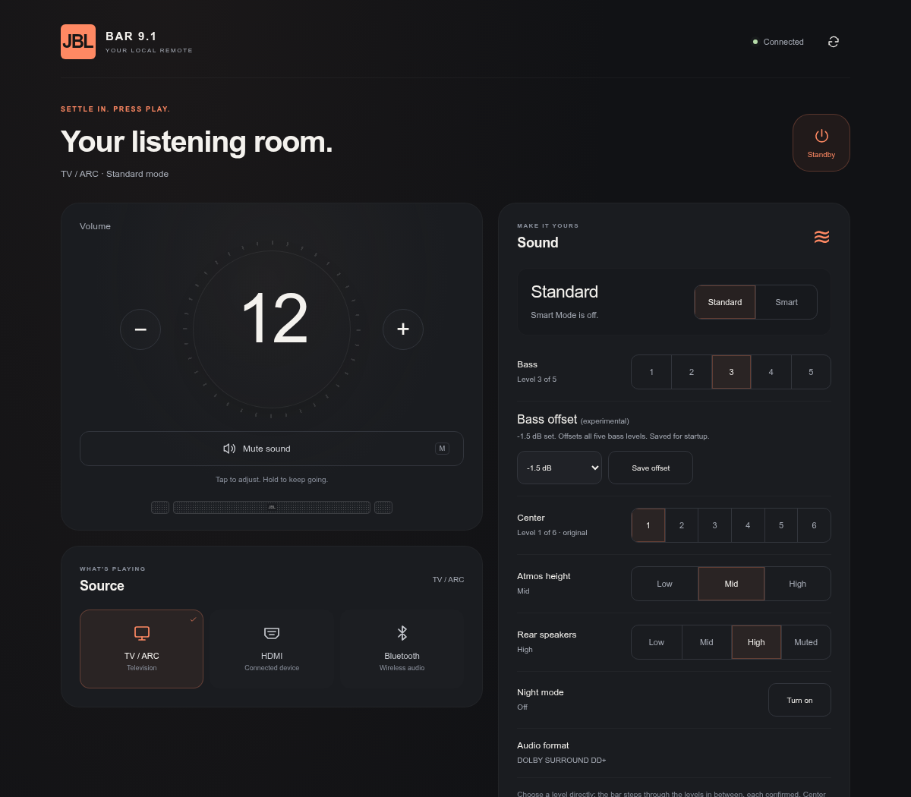
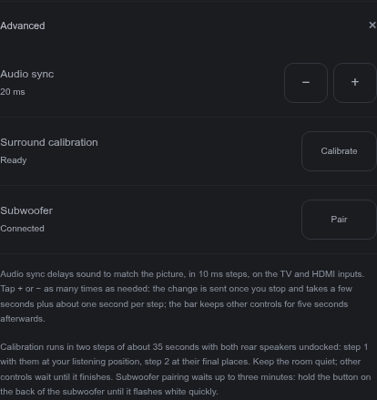

# JBL Bar Toolkit

**Control your JBL Bar 9.1 from your phone or computer.** Change the volume,
choose what is playing, and adjust the sound in a browser on your home network.
No cloud account or app to install. Disable automatic smart mode on power on.



*Screenshot uses sample data, not a connection to a real soundbar.*

**Still experimental.** Bar 9.1 is the only model with an installation package.
Individual features have been tested on a bar; the complete public USB install,
restart and recovery process still needs hardware testing.

## What you need

- A **JBL Bar 9.1 True Wireless Surround** on your home network.
- A Windows, macOS or Linux computer. First installation and recovery also need
  a USB stick; the setup tool can format it as **FAT32 / MBR**.
- Your phone or computer connected to the same home network as the bar.

Already using an older installation? **Keep its original USB and recovery ZIP.**
With toolkit SSH already enabled, use **Network update (SSH)** and enter your SSH
password—no USB is needed. Otherwise, choose **USB setup** and **Install / update everything**. It detects
your setup, updates toolkit components while keeping installed settings and SSH
keys, or migrates the recognized older standalone setup. Unknown installations
stop with an explanation. [Existing installation guide](models/bar91/README.md).

## Get started

1. **Download the setup executable.** In [Releases](https://github.com/kisinga/jbl-bar-toolkit/releases),
   choose `jbl-setup-OS-ARCH` for your computer (`.exe` on Windows). `amd64` is
   Intel/AMD; `arm64` includes Apple Silicon. Run it from your computer, outside
   the USB you plan to format. No installer, Go or Python is needed. On Linux
   and macOS, allow execution with `chmod +x <downloaded-file>` if necessary.
   The executable is unsigned; your OS may ask you to allow it.
2. **Prepare your USB.** The app opens a local browser interface and downloads
   and verifies the toolkit and recovery files. Choose **USB setup**, select your USB and home
   network and features, and leave **Check compatibility first** selected.
   Enable formatting only if needed, then **Prepare selected USB**. Formatting
   erases that entire drive and asks for administrator permission. Save the
   recovery ZIP on your computer.
3. **Check your bar.** Setup safely ejects the verified USB. Insert it into the awake bar,
   and wait **five minutes**. Reconnect it to your computer, refresh drives in
   setup, and open **Soundbar check results**. Continue only if `STATUS.txt`
   says `CHECK_PASSED_READY_FOR_INSTALL_OR_CONFIGURE`.
4. **Install.** Choose **Install / update everything** and prepare the same USB
   again, with formatting off. After successful eject, insert it into the awake
   bar, and wait five minutes. Read the results afterward; expect
   `INSTALLED_PENDING_REBOOT_TEST`.
5. **Use your remote.** Remove the USB and open **[jbl.local](http://jbl.local)**.
   Unplug the bar from power for **60 seconds**, reconnect it, let it finish
   starting, and turn it on. Keep the USB out. Check the browser remote and
   your normal audio controls.
6. **Confirm the restart.** In setup, choose **Verify after a restart without USB**
   and prepare the stick again without formatting. Insert it into the powered-on
   bar and wait five minutes. Expect `VERIFIED_CURRENT_BOOT_PENDING_USER_TESTS`
   in its results. Check normal playback and volume, then remove and keep it.

The interface runs locally. USB credentials are derived locally and written to your
stick; keep it private. The computer app checks files and reads reports;
firmware compatibility checks still run on the soundbar.

For **offline setup**, download the matching `…-setup-OS-ARCH.zip`, extract it
on your computer, and run the executable beside its included toolkit/recovery
ZIPs. No network is required unless you request an update. `SETUP.html` now points
to this tool rather than generating a file for you to move manually.

**No toolkit release available yet?** Development packages are under **Artifacts** on a
successful [Test and package toolkit run](https://github.com/kisinga/jbl-bar-toolkit/actions/workflows/package.yml).
Sign in to GitHub and download **jbl-bar-toolkit-usb-development**. Extract
GitHub's outer ZIP, then extract the matching `…-setup-OS-ARCH.zip` offline bundle.
Run its executable beside the included toolkit/recovery ZIPs. These downloads expire after 30 days.

## Update later

Run the same setup tool and choose **Check for updates** to get the latest toolkit
and matching recovery files. Repository runs build the current checkout instead.

**SSH already enabled on your bar?** Choose **Network update (SSH)**:

1. Keep the bar fully on and connected to the same home network. Leave the address
   as `jbl.local`, or enter its private IPv4 address if discovery fails.
2. Enter your SSH password and choose **Check connection**. On the first connection,
   confirm the speaker’s public host key; it is remembered on this computer.
3. Choose **Update bar**. The tool verifies the transfer, runs the existing guarded
   updater and checks the installed files. Read the result, restart and check normal playback.

This works from both a downloaded executable and `go run ./apps/usbsetup --repo .`.
SSH is built in; no SSH client installation or USB is needed for a network update.
Your password is not saved. It uses the toolkit’s existing root login on port
2222 and refuses changed host keys or modified installations. Physical network-update
and reconnect qualification remains pending.

**Without SSH**, choose **USB setup**. Back up your old USB and use a clean stick or explicitly format it for a new
package; the tool refuses to mix versions on a configured stick. Choose
**Install / update everything**, prepare the USB, insert it into the powered-on
bar and wait **five minutes**. Read its results afterward; expect
`INSTALLED_PENDING_REBOOT_TEST`, then repeat the restart checks above. Keep each
installation's original recovery ZIP.

**Update this setup app** updates the computer-side executable itself. Restart it
afterward. It adds no installer or background service. First installation,
enabling SSH, deliberate settings changes, legacy migration and recovery use USB setup.

An existing toolkit keeps its installed feature/network settings, SSH credentials,
SSH host keys and saved sound settings. The update replaces the bundled app and
scripts; it does not flash JBL firmware. Use **Apply configuration changes** separately if you want to change features. Keep the matching recovery
ZIP. A failed update can disable services; its status and recovery instructions
explain the next step.

## Make the sound yours

| Control | What it does |
| --- | --- |
| Volume, mute and source | Everyday controls for TV/ARC, HDMI and Bluetooth. |
| Playback | Play, pause and skip when the connected source supports them. |
| Bass **1–5** | Pick a bass level directly. The toolkit handles the steps and confirms the result. |
| Bass offset **(experimental)** | Fine-tune all five bass levels from **−3 to +3 dB**, in half-decibel steps. Pick an offset, then press **Save offset**. **0 dB** restores stock bass on the next supported playback route. |
| Center **1–6** | Boost the dialogue channel. **1** is the original level; higher levels add gain. |
| Rear speakers and Atmos height | Adjust the rear speaker level and the height effect for Atmos audio. |
| Standard / Smart | Choose the sound mode. During setup you can also enable automatic Standard Mode after wake, or remember the mode you chose before standby. |
| Night mode | Toggle it when the bar reports support. |

Bass offset is saved for restarts and applied during supported, stable
**Standard Mode** playback. It may wait or pause on other audio routes. Start
at a comfortable volume; extra bass or center gain can distort at high volume.
[How bass offset works](docs/BASS_OFFSET.md).

The listening room keeps source controls and volume beside a view of the speakers,
with last-reported rear battery levels next to each speaker. **Sound** and
**Front EQ** sit side by side on larger screens. **Audio sync** (lip sync),
**Bass offset**, and **System monitor** start expanded; **Room setup** contains
rear speaker calibration and subwoofer pairing.

Default setup packages include the project-owned Front EQ and Bluetooth playback
helpers. Controls remain subject to device, firmware and audio-route checks. Front EQ is
limited to supported Standard playback routes and is kept until turned off. System monitor shows device health
and network information when available. [Feature and setup details](docs/models/bar91/USB-TOOLKIT.md).

To use the same controls from Home Assistant, install the separate
[JBL Bar Toolkit for Home Assistant](https://github.com/naonak/jbl-bar-toolkit-ha)
integration ([setup](docs/models/bar91/STANDALONE.md#home-assistant)).



## Need help?

- **The remote page will not open:** try the bar's IP address from your router's
  connected-device list, such as `http://192.168.1.50`. If needed, try
  `http://192.168.1.50:8080`. Your phone and bar must be on the same home network.
- **The USB check is blocked:** read **Soundbar check results** in setup, including the native
  check and latest setup log. The files under `JBLToolkit/` explain what failed. Use the
  [installation and recovery guide](docs/models/bar91/USB-TOOLKIT.md) for next steps.
- **Need to undo an installation:** use the matching recovery ZIP and the
  [recovery instructions](docs/models/bar91/USB-TOOLKIT.md). Keep the original files
  for your installed version.
- **Have another model:** Bar 800, 1000, 1300/1300X, MK2 and other models do not
  have installers yet. See [supported hardware](docs/HARDWARE.md).

## Run from this repository

With **Go 1.25.7 or newer**, a browser, and your OS's normal USB permissions,
run from the repository root (Linux, macOS or Windows):

```sh
go run ./apps/usbsetup --repo .
```

The `.` is required: `--repo` takes the checkout path. Keep the terminal open.
The app builds USB/recovery files from this checkout using the same Go builder
as CI. Restart after source edits. No Python or BusyBox is needed for setup.
Generated files stay under `build/setup-payload-…/`.
A successful write verifies the USB and automatically ejects it; if eject fails,
the interface asks you to eject it through your OS.

Downloaded platform executables run independently of the repo and need no Go,
Python or installation. They fetch and verify published toolkit/recovery files,
and offer self-update. Offline bundles include those files already.

## For contributors

```sh
go run ./apps/build               # Shared builder: apps, offline bundles and USB ZIPs
./jbl dev                         # Local remote preview with sample data
./jbl test                        # Fast Go checks
./jbl test --full                 # Complete checks; see requirements below
```

[Development requirements and checks](CONTRIBUTING.md).

[Contributing](CONTRIBUTING.md) · [Changelog](CHANGELOG.md) ·
[Releasing](docs/RELEASING.md) · [Code layout and components](docs/COMPONENTS.md) ·
[Bar 1300 research](research/bar-family/bar1300/README.md)

Independent project; not affiliated with JBL. MIT covers project code and
documentation. Vendor firmware and proprietary libraries are not bundled.
[Credits](docs/models/bar91/STANDALONE.md#credits).
