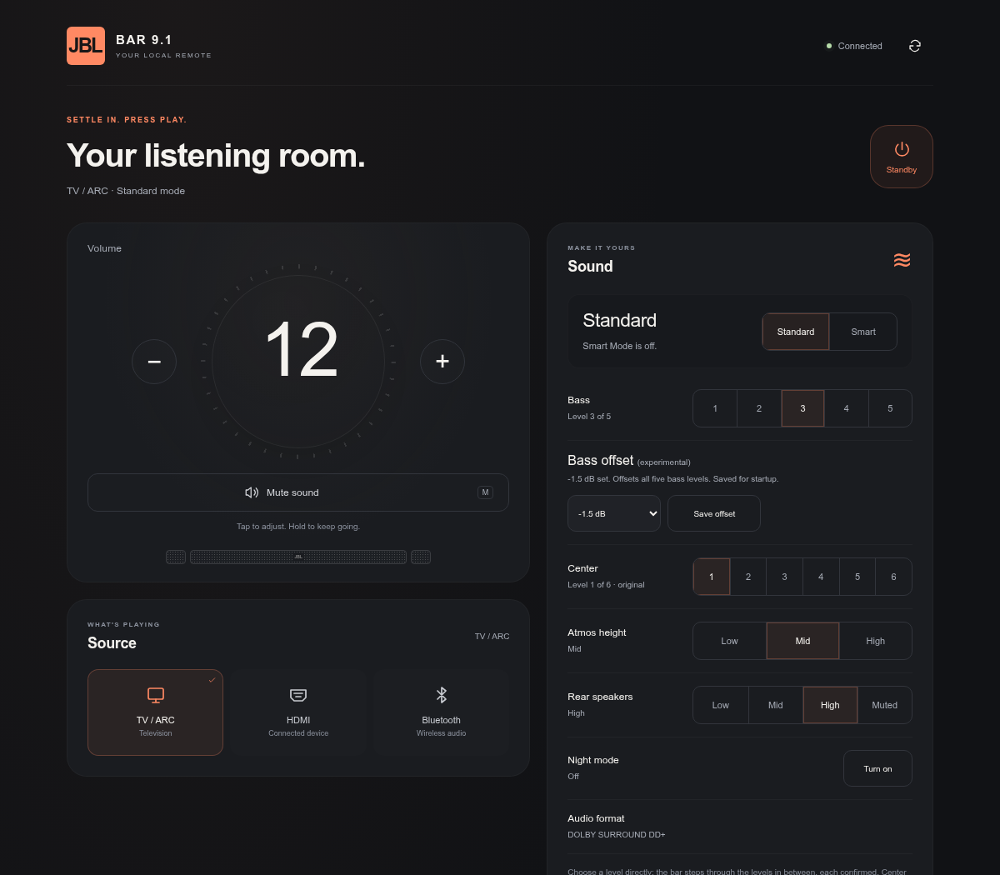

# Standalone installers and control reference

For the new combined USB installer, start with the [toolkit guide](USB-TOOLKIT.md). This page preserves the separate installers and detailed control reference.

Control playback and tune Front EQ from a browser, disable Smart Mode automatically after wake, or enable root SSH for further development. Each tool runs on the bar; no ongoing computer service is required.

| Tool | Source | Function |
| --- | --- | --- |
| [Browser remote](#local-browser-remote) | [`apps/remote/`](../../../apps/remote/) | Local Go interface, Front EQ, playback and sound controls, plus an optional CLI. |
| [Smart Mode off](#smart-mode-off) | [`models/bar91/smart-mode/`](../../../models/bar91/smart-mode/) | Install once from USB; select Standard Mode automatically after wake. |
| [Root SSH](#root-ssh) | [`models/bar91/ssh/`](../../../models/bar91/ssh/) | USB-free root terminal access and SFTP. |

**Experimental: hardware validation covers one Bar 9.1 and the [exact firmware identities below](#compatibility).** This project is not affiliated with JBL. The former repository name was `jbl-bar9-standard-mode`; existing release filenames remain unchanged.

Install **Smart Mode → SSH → browser remote**; remove in reverse order. Each installer preserves the startup hook it finds. Use only one AutoScript USB package at a time.

## Local browser remote



Open **[http://jbl.local](http://jbl.local)** on the configured LAN, or **`http://<bar-ip-address>`** if mDNS is unavailable or the name conflicts. Port `8080` also works. No web login is required; SSH keeps its separate password. [Build and install the remote](DEVELOPMENT.md#browser-remote).

- **Listening:** volume, mute, power, source and Standard Mode. Tap or hold +/−; use ↑/↓ or M on a keyboard. Clear queued taps to cancel unsent changes.
- **Playback:** one Play/Pause button, Previous/Next and Stop when supported. Bluetooth requires the optional native helper. Bluetooth and AirPlay distinguish requested actions from stream/session activity; mirrored Cast audio has no sender controls.
- **Bluetooth:** connected device name, native stream activity, pairing status and a pairing button. Finish pairing in the sending device’s Bluetooth settings. Cached names can lag a rename; track metadata is not currently available over Bluetooth.
- **Rear batteries:** separate left/right charge percentages from the firmware, updated with live status. These are last reported levels and may lag when speakers are off; docking does not establish active charging. Missing readings show Unavailable.
- **Sound:** Night Mode, five bass levels, six center (dialogue) levels (level 1 is the original sound; the API reports them as 0 to 5), three Atmos height levels and rear level/mute. Undock both rear speakers to adjust them. Atmos height does not identify the current audio format. Center level is experimental: it sets the center amplifier's channel gain (levels 0–5: 0 to +12 dB in 2.4 dB steps, level 0 = original, boost only; high levels can clip at loud volume), is re-applied after each wake and is reported as requested, without amplifier readback.
- **Front EQ (experimental):** choose Original, Less bass, Clear dialogue, Softer treble, Warm, Bright or Vocal focus, then press **Apply EQ**. Adjust five sliders for manual tuning; dragging only previews changes. Cuts range from −6 to 0 dB relative to original front-channel tuning, in 0.5 dB steps. To turn it off, choose **Original** and press **Turn off EQ**; this restores native processing, even in standby or Smart Mode, where the bar finishes once Standard audio plays. A badge next to the title says whether the EQ is **Active** (heard now), **Waiting** (with the reason), **Updating** (the bar changed its processing; the remote follows within seconds) or **Off**; there is nothing to reset by hand. EQ uses custom front-channel DSP and is kept until turned off: it follows bass, Atmos, rear and Night changes, and after an input change, Smart Mode, standby or a restart it is applied again once Standard audio plays (about 2 s muted). Web power and setup controls still remove it first. While it cannot apply (standby, Smart Mode, an unsupported input or audio route), the bands stay adjustable: **Save EQ** keeps the new curve, and it is applied once Standard audio plays. It needs listening tests beyond Bluetooth. [Build with the optional EQ helper](DEVELOPMENT.md#optional-front-eq-helper).
- **System monitor:** CPU/RAM history, storage, Wi-Fi status/traffic, load averages, uptime and process count. Updates every two seconds with up to two minutes of browser-local history; missing sensors stay unavailable.
- **Streaming and details:** AirPlay session activity, Cast application/track metadata when supplied, automation status and read-only Cast tone settings. AirPlay cannot distinguish pause. Chrome Audio Mirroring can remain PLAYING when its sending app pauses; the page labels that limitation.

[Optional Go wake automation](DEVELOPMENT.md#optional-go-wake-automation) shares the web controls’ lock and readback, replacing the shell poller while the service runs. It retains the verified button gesture and restores the shell helper when stopped or uninstalled. Enable it with `--auto-standard`; three controlled wakes measured **7.77–7.82 seconds** on the test bar ([device record](../../../models/bar91/validation/go-automation-device.json)). Soundbar details show what the automation did after the last wake (for example “Standard restored after wake”) and, with `smart_mode_memory`, the mode the next wake restores (“next wake: Smart”).

Live updates use one event connection while the page is visible. The state reports `control` (`busy`, `action`, `since`) while any control holds the bar, including one sent from another page, Home Assistant or the wake automation; the page then waits, and state reads and new event connections answer with the latest state instead of waiting for the control. No database is required. Short transitions respect reduced-motion preferences. Volume previews immediately and confirms from native state. Connection loss clears unsent changes and remembered playback intent; actions are never replayed automatically.

[Validation records](../../../research/README.md) cover volume/mute, Bluetooth pairing/name/stream readback, Night Mode and bass/height cycles, TV/ARC → HDMI → Bluetooth selection, normal Cast Play/Pause/Stop and USB-free web/SSH startup. Bluetooth playback depends on sender support; [Brave/YouTube currently accepts commands without pausing](../../../models/bar91/validation/bluetooth-sender-device.json). AirPlay playback, Bluetooth/Cast skip controls, undocked rear adjustment and broader power/source/CEC behavior need further confirmation.

Access is limited to the configured LAN, with fixed commands, firmware checks and same-origin/CSRF protection. When the native setup hotspot is already active, use **`http://192.168.255.249`** from that network. Automatic hotspot activation after Wi-Fi loss and captive-portal opening remain unconfirmed.

For terminal control, use Python 3 without additional packages:

```sh
python3 tools/jbl.py status
python3 tools/jbl.py night on
python3 tools/jbl.py smart off
```

Also available: `volume up|down`, `mute`, `power`, `source tv|hdmi|bluetooth` and supported playback commands. Use `--host <private-ipv4[:port]>` for an IP address or `--json` for token-free state. Night and Smart Mode commands check state before changing it; manual `smart off` preserves the automatic watcher.

### Home Assistant

[JBL Bar Toolkit for Home Assistant](https://github.com/naonak/jbl-bar-toolkit-ha) (`naonak/jbl-bar-toolkit-ha`, formerly `naonak/jbl-bar-9.1-ha`) is a separate integration, installable through HACS. It talks to this browser remote's local API (`/api/state`, `/api/events`, `/api/action`, `/api/features`) on the LAN, with no cloud or extra hardware. Like the packaged remote it supports the Bar 9.1 only: setup checks the model the remote reports and refuses another bar.

It provides:
- a media player: power, volume, mute, source, playback and now playing;
- bass, center (1–6), Atmos and rear levels, and the experimental bass offset;
- Night and Smart Mode switches, Front EQ presets and bands, and audio sync;
- surround calibration and subwoofer pairing buttons;
- the audio format, a "Command running" sensor, the mode restored after standby (with `smart_mode_memory`), and diagnostics.

Entities appear only for the controls the installed remote reports. Commands wait for a control already running on the bar, whoever sent it.

1. In HACS, add `https://github.com/naonak/jbl-bar-toolkit-ha` as a custom repository (Integration), install **JBL Bar Toolkit (Bar 9.1)**, then restart Home Assistant. If you added the old `jbl-bar-9.1-ha` URL, replace it: the domain and entities are unchanged.
2. Add the integration and enter the bar's IP address. Without a port it uses `8080`, which the remote also answers on port 80. Include the port if you set a custom `web_port`.
3. Home Assistant's address must be inside the remote's trusted LAN (`allowed_cidr`); otherwise the remote answers 403.

Report integration issues in [its repository](https://github.com/naonak/jbl-bar-toolkit-ha/issues).

## Smart Mode off

Install once, then remove USB. The helper waits indefinitely in standby and selects Standard Mode after wake. It automates JBL’s normal button sequence; it does not change the saved firmware default or flash firmware.

### Download

- **[Install ZIP](https://github.com/kisinga/jbl-bar-toolkit/releases/download/v0.1.0/jbl-bar9-standard-mode-v0.1.0-install.zip)**
- **[Uninstall ZIP](https://github.com/kisinga/jbl-bar-toolkit/releases/download/v0.1.0/jbl-bar9-standard-mode-v0.1.0-uninstall.zip)** — keep a copy.
- [Release notes and SHA-256 checksums](https://github.com/kisinga/jbl-bar-toolkit/releases/tag/v0.1.0)

Use the release ZIPs, rather than GitHub’s source archive. No configuration is needed. Source builds now contain revision 6: faster timing measured at about **18 seconds** on the test bar, versus about 35 seconds for revision 5. The linked v0.1.0 ZIPs remain unchanged. [Build and qualification details](DEVELOPMENT.md#faster-wake--revision-6).

### Requirements

- **JBL Bar 9.1 True Wireless Surround** matching the supported executables. The recorded firmware label is **23.06.41.80**; its display version has not been independently verified.
- Working **FAT32 USB**, first partition of the first USB disk (`/mnt/sda1`). A 512 MiB partition was tested; that size is not a requirement. Back up files before formatting.
- Computer for ZIP extraction/logs, and the soundbar remote.

No firmware download, soldering, developer tools or ongoing network service is needed.

### Install

1. Download both ZIPs; keep the uninstall package on the computer.
2. Extract the install ZIP’s contents directly to a clean USB root. Check for `AutoScript/AutoScript`, `JBLInstall/`, `README.txt`, `ROLLBACK.txt`, `manifest.json` and the license, with no enclosing folder or another AutoScript package.
3. Turn the bar fully on and wait for normal playback. Insert USB and leave controls alone for **2 minutes**. Audio briefly mutes during the sequence.
4. Expect **SMART MODE OFF** if Smart Mode was enabled. Return USB to the computer. `JBLInstall/INSTALL_STATUS.txt` must say `INSTALLED_PENDING_REBOOT_TEST` or `ALREADY_INSTALLED_LOGS_EXPORTED`; otherwise follow [troubleshooting](#troubleshooting).
5. Remove USB, disconnect mains for **60 seconds**, reconnect and let LOAD finish. Turn the bar on whenever convenient. Allow **60 seconds** for Standard selection; verify audio, volume, mute and standby.

There is **no standby deadline**. If Standard is already selected, no action/message is needed. After a wake is handled, manual Smart Mode selection is respected until the next observed standby/wake. Very short standby transitions may be missed.

### Remove or recover

Remove **browser remote → SSH → Smart Mode** before changing an earlier startup hook. Follow [browser removal](DEVELOPMENT.md#browser-remote) and [SSH rollback](DEVELOPMENT.md#ssh-package).

Removing USB does **not** uninstall the helper. Extract the matching uninstall ZIP to a clean FAT32 USB root, insert into the powered bar and wait **100 seconds**. Require `JBLInstall/UNINSTALL_STATUS.txt` to show `UNINSTALLED` or `ALREADY_UNINSTALLED`; remove USB and restart.

Alternatively, add an empty `JBLInstall/ROLLBACK` file to the install USB, with **no `.txt` extension**. Removal waits for active work, saves files to `JBLInstall/uninstalled-backup` and preserves unknown hooks. For `HOOK_DISABLED_REBOOT_TO_FINISH_UNINSTALL`, reboot with rollback USB connected; once fully on, remove/reinsert it, wait 100 seconds and check again.

If LOAD persists or controls stop responding, insert rollback USB and allow removal to finish. If still unresponsive, disconnect mains and reconnect with rollback USB inserted, then inspect removal logs. Do not interrupt a normal installation/removal. If rollback does not restore normal boot, stop repeated experiments and seek device-specific recovery help.

### Compatibility

Match these exact SHA-256 identities; a version label alone is insufficient:

| Executable | SHA-256 |
| --- | --- |
| `bdpprog` | `86ec83472a10dd4278285123f8ecbfb96bdd97444dd98c3a56d5d87441c90b63` |
| `cli` | `8910fb852d2f994a519615fede404fbb036e3a8f5264cc69cdff57038af3c78f` |

The expected writable `/var` environment is also required. Keep identity guards intact; other models/builds are unsupported without validation. Firmware updates can remove the helper or invalidate its checks. v0.1.0 accepts fresh installation, its exact installed version and recognized revision 4; unknown versions/hooks are preserved.

[Bar 800/1000/1300 research](../../../research/bar-family/README.md) records historical
firmware comparisons, community protocol references and offline native replay.
It does not establish compatibility with these installers.

### Troubleshooting

No new `install.log`/`update.log`: check FAT32, USB root layout and absence of `JBLInstall/ROLLBACK`. Start only after normal playback.

| Result | Action |
| --- | --- |
| `TRIAL_NOT_SUCCESSFUL_NO_INSTALL` | Read `trial/STATUS.txt` and `trial/latest.log`; no new helper was installed. |
| `STOPPED_LONG_PRESS_NOT_CONFIRMED` | If controls work, let the bar settle and retry insertion once without touching controls. Stop if repeated. |
| `FIRMWARE_MISMATCH` / `CLI_MISMATCH` | Keep guards intact; the build is unsupported. |
| `EXISTING_AUTOSCRIPT_PRESERVED_NO_INSTALL` / `INSTALLED_VERSION_CONFLICT` | Preserve the existing hook/version; do not overwrite blindly. |
| `runtime/STATUS.txt`: `STANDARD_SELECTED` | Confirmed mode change; check the boot ID. |
| `runtime/WATCH_STATUS.txt`: `STANDARD_THIS_WAKE` | This wake was handled. |
| `runtime/DISABLED` | Collect logs and uninstall. Reinsertion does not clear the guard. |

`UPDATE_STATUS.txt=SETUP_FINISHED` alone is insufficient: check `INSTALL_STATUS.txt` and the install log’s `EXIT=`. An upgrade’s uninstall status may refer to the previous version.

To export wake logs, reinsert the same install USB for **15 seconds**. Inspect `JBLInstall/runtime/watch.log`, `latest.log`, `last-attempt/result.txt` and `last-attempt/JBLTest/result.txt`. Compare boot IDs/uptime; wall-clock time and older component headers can mislead. Reinsertion exports logs without replaying the sequence.

[Report an issue](https://github.com/kisinga/jbl-bar-toolkit/issues) with model, displayed firmware (or unknown), timing, normal control behavior and cold-boot/standby/CEC results. Review text logs before attaching them; omit full dumps and personal/network information.

### Implementation and validation

`/var/JBLStandard` and `/var/AutoScript.TSS` run a guarded watcher. It checks readiness/mode, temporarily changes two console fields in RAM, sends mute-hold/volume-up, verifies Standard and released keys, then restores the fields. Executable instructions remain unchanged. Revision 5 includes inherited-socket cleanup and disappearing-descriptor handling; preserve both when modifying startup scripts.

The confirmed 19 October 2026 cold boot detected awake at uptime 134.67 seconds and completed at 169.22: **34.55 seconds**, with mode `3 → 0`, released keys and `CONSOLE_RESTORED=1`. USB removal was reported for that test; logs alone do not establish its absence. The first installation required a retry. Repeated standby/CEC paths remain unverified. The original release passed **102 host checks** and matched reproducible fresh-clone/anonymous downloads; the later standalone suite passed **141 host checks**. The combined toolkit adds its own [host fixtures](DEVELOPMENT.md#build-and-test).

## Root SSH

[Build a private SSH package](DEVELOPMENT.md#ssh-package) using Python 3 on Linux. Choose a password and the single computer IPv4 address allowed to connect. No shared default password is provided. The native OpenSSH daemon uses port **2222**; setup can reuse configured Wi-Fi or provision it interactively.

Verify the exported host-key fingerprint, then connect:

```sh
ssh -p 2222 root@<bar-ip-address>
```

USB-free startup, password login, an interactive shell and SFTP were confirmed on 20 October 2026, with Wi-Fi and normal controls restored after reboot. The portable installer still needs an independent clean-install test. Smart Mode release ZIPs do **not** install SSH.

Account files, startup scripts and the private compatible loader/library view stay in writable `/var`; firmware binaries are not replaced. Keep the matching recovery ZIP and a stable computer LAN address. Remove the browser remote before rolling back SSH.

Use compatible **32-bit ARM Linux** programs within the device’s limits: approximately **448 MiB RAM** and **25 MiB free writable storage** in the recorded capture. Android-derived/Chromecast services are present; no normal APK package manager/runtime was found.

## Credits

- **[touch MAX’s 8 January 2024 article](https://touch-max.ru/vzlom/zapusk-ssh-na-proshivke-jbl-9-1) and [almirus/jbl9.1](https://github.com/almirus/jbl9.1/tree/master/AutoScript):** published USB entry point and persistent-storage foundation. The article is credited to `admin` and links that GitHub handle; it does not establish their personal identity. It also acknowledges earlier MediaTek/Blu-ray AutoScript work.
- **JBL:** [manual Smart Mode sequence and reset on power-on](https://support.jbl.com/howto/jbl-bar-9-1-lacking-dialogue-too-much-surround-us/000017755.html).
- **[k1rnt/JBL Soundbar CLI](https://github.com/k1rnt/jbl-soundbar-cli/tree/7d10bdb1ebe0c5a77c9a4c14ebe4580bd3735309):** CLI/control/discovery inspiration. Its newer Linkplay/JBL One transport is separate from the native Bar 9.1 implementation and does not supply this persistent wake watcher.
- **SimenCodes:** [related Smart Mode automation](https://github.com/MrBearPresident/JBL_Soundbar/pull/6), merged 11 November 2024 and tested on Bar 1000. That separate network-based implementation does not establish support for that model here.

Build-specific mode/readiness analysis, guarded automation, console restoration and standby handling extend the published foundation; no world-first claim is made. MIT covers the distributed code/docs, not vendor firmware or linked upstream material. Vendor firmware and proprietary binaries are not bundled.

[Development and builds](DEVELOPMENT.md) · [Community links and post draft](../../../COMMUNITY.md) · [Research archive](../../../research/README.md)
