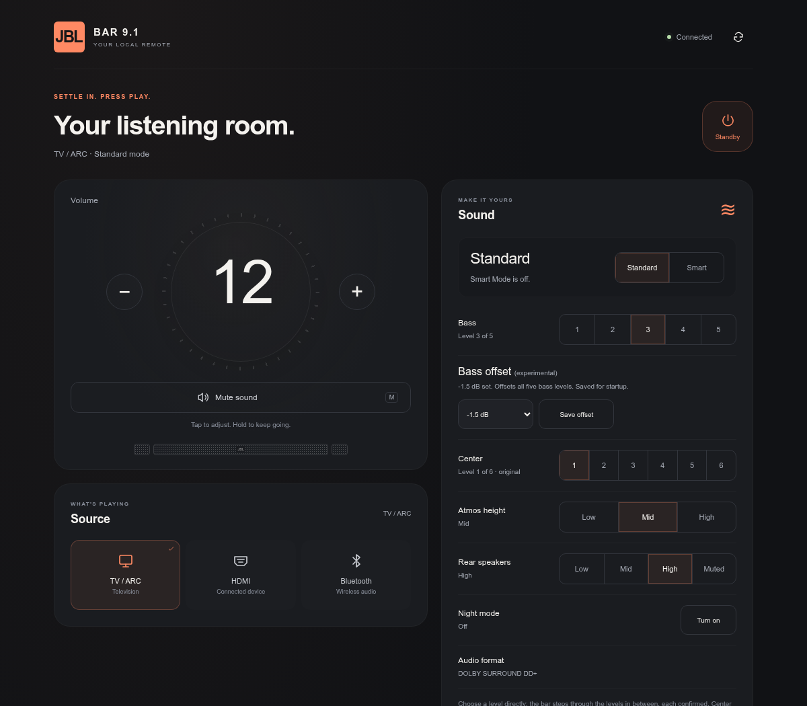

# JBL Bar 9.1 toolkit

[Toolkit overview](../../README.md) · [Architecture](../../docs/ARCHITECTURE.md)

Build commands below run from the repository root.

A local browser remote, automatic Smart Mode off, and root SSH for the **JBL Bar 9.1 True Wireless Surround**. The canonical process installs selected features from one FAT32 USB drive, then removes it. Everything runs on the soundbar; no ongoing computer service is needed.



**Experimental · exact firmware checks · reversible startup changes · no firmware flashing**

The combined USB toolkit is a **development build with host integration tests**. Its native inspection and bundled helper-library checks passed on one bar; the complete installation and recovery flow still needs hardware qualification. Individual features have been tested on one Bar 9.1. Other JBL models are unsupported.

[Set up the USB toolkit](../../docs/models/bar91/USB-TOOLKIT.md) · [Configuration](#configuration) · [Compatibility](#compatibility) · [Recovery](#recovery)

## What you get

| Feature | What it does | Optional? |
| --- | --- | --- |
| Browser remote | Volume, mute, source, playback, sound controls, rear battery readings and system status at `http://jbl.local`. | Yes |
| Automatic Standard Mode | Selects Standard Mode after wake, using the normal Smart Mode off gesture. Works with the browser interface disabled. | Yes |
| Root SSH and SFTP | Terminal access on port `2222`, restricted to your configured LAN and protected by your own password. | Yes |
| Wi-Fi provisioning | Optionally joins a WPA2 network during installation; otherwise reuses the bar's configured Wi-Fi. | Yes |
| Bluetooth playback / Front EQ | Additional controls when the package is built with the optional native helpers. | Build option |

The browser remote also provides Night Mode, bass, height, rear level/mute and an experimental center level. Some controls depend on the active source or undocked speakers. [Control details and limitations](../../docs/models/bar91/STANDALONE.md#local-browser-remote).

## Canonical installation and legacy recovery

| Path | Status | Start here |
| --- | --- | --- |
| **Combined USB toolkit** | Build locally; complete device qualification pending. One config selects all three features. | [USB setup guide](../../docs/models/bar91/USB-TOOLKIT.md) |
| **Published Smart Mode only** | Historical `v0.1.0` release; its recorded cold-boot test was on one bar. Installs neither SSH nor the browser remote. | [Install ZIP](https://github.com/kisinga/jbl-bar-toolkit/releases/download/v0.1.0/jbl-bar9-standard-mode-v0.1.0-install.zip) · [Matching uninstall ZIP](https://github.com/kisinga/jbl-bar-toolkit/releases/download/v0.1.0/jbl-bar9-standard-mode-v0.1.0-uninstall.zip) |
| **Existing standalone installation** | Keep using its matching installers and recovery instructions. The toolkit preserves it and refuses automatic migration. | [Standalone guide](../../docs/models/bar91/STANDALONE.md) |

There is no published combined toolkit ZIP yet. GitHub's **Download ZIP** is source code, not an installation USB. Keep the published Smart Mode release and its recovery package separate from toolkit builds.

## Configuration

Copy [`models/bar91/usb/config.example.txt`](usb/config.example.txt) to a private working file, set your actual LAN subnet, and choose the features:

```ini
format=1
action=install
ssh=true
web_remote=true
auto_standard=true
allowed_cidr=192.168.1.0/24
web_port=80
```

Build the package on Linux with Python 3.10+, BusyBox and Go 1.22+:

```sh
mkdir -p dist
cp models/bar91/usb/config.example.txt dist/toolkit-config.txt
# Edit dist/toolkit-config.txt before building.
python3 tools/build_usb.py --config dist/toolkit-config.txt
```

If SSH is selected, the builder privately prompts for a new password. Add `--wifi` to provision WPA2 Wi-Fi. The output includes a private install ZIP, a credential-free recovery ZIP and checksums under `dist/toolkit-private/`.

Use `tools/prepare_usb.py` to stage and verify the package on a clean FAT32 USB root. First run `action=check` on the fully powered-on bar and inspect its blockers/native report, then use `action=install` and leave controls alone for **five minutes**. Return USB to the computer and require `JBLToolkit/STATUS.txt` to say `INSTALLED_PENDING_REBOOT_TEST`. Follow the [full guide](../../docs/models/bar91/USB-TOOLKIT.md) to verify the SSH fingerprint, test a USB-free mains restart, collect `action=verify` evidence and exercise recovery.

To change features later, edit `JBLToolkit/config.txt` on the **same installation USB** and set `action=configure`. Reinserting with `action=install` only exports logs; it does not reapply settings or restart services. See the [configuration reference](../../docs/models/bar91/USB-TOOLKIT.md#configuration-reference) for supported combinations and customization limits.

Anyone on the configured trusted LAN can use the web remote without a web login. SSH has its separate password. Keep the private install ZIP and USB secure: they can contain a password hash and a derived Wi-Fi key.

## Compatibility

Support is restricted to the recorded **Bar 9.1** executable identities. The recorded firmware label is **23.06.41.80**; a matching version label alone is insufficient.

| Executable | Required SHA-256 |
| --- | --- |
| `bdpprog` | `86ec83472a10dd4278285123f8ecbfb96bdd97444dd98c3a56d5d87441c90b63` |
| `cli` | `8910fb852d2f994a519615fede404fbb036e3a8f5264cc69cdff57038af3c78f` |

The toolkit also checks persistent writable storage, free space and, when selected, the native SSH tools. Unsupported builds fail before installation. Keep these checks intact. Firmware updates can remove the installed services or invalidate compatibility.

[Bar 800/1000/1300 research](../../research/bar-family/README.md) records historical firmware comparisons, community protocol references and offline native replay. It does not establish compatibility with these installers.

## Recovery

For the **toolkit**, set `action=uninstall` or create an empty `JBLToolkit/RECOVER` file on the installation drive. Alternatively, extract the matching recovery ZIP to a clean FAT32 drive. Insert into the powered-on bar, wait **two minutes**, and require `RECOVERED_REBOOT_REQUIRED` in `JBLToolkit/STATUS.txt`. Remove USB and restart.

Recovery disables the managed services and restores the exact original startup hook when recognized. Files, credentials and Wi-Fi settings are retained; existing SSH sessions can remain until reboot. An externally changed startup hook is preserved and reported for manual review. [Full recovery instructions](../../docs/models/bar91/USB-TOOLKIT.md#recovery).

For **standalone installations**, use their [matching recovery instructions](../../docs/models/bar91/STANDALONE.md#remove-or-recover). Removing USB alone never uninstalls a persistent service.

## Troubleshooting

| Result | Next step |
| --- | --- |
| No new `JBLToolkit/setup.log` | Check FAT32, the first USB partition, USB root layout and the bar being fully on. |
| `CONFIG_INVALID` | Read the configuration error in `setup.log`; use the supplied keys and exact `true`/`false` values. |
| `PREFLIGHT_FAILED_CHECK_FIRMWARE_STORAGE_AND_NATIVE_SSH` | Check the supported firmware, writable storage/free space and native SSH requirements. |
| `EXISTING_COMPONENT_REMOVE_WITH_ORIGINAL_INSTALLER` | Follow the standalone recovery/migration instructions; preserve existing files. |
| `PACKAGE_VERSION_CONFLICT_USE_ORIGINAL_USB` | Use the same package that installed the toolkit. Cross-version upgrades and credential rotation need a separate migration. |
| `BUSY_RETRY_AFTER_BOOT_OR_CURRENT_OPERATION` | Let boot/current work finish, then reinsert. |
| Other failure or incomplete recovery | Read `setup.log`, retain the drive and use the [detailed troubleshooting guide](../../docs/models/bar91/USB-TOOLKIT.md#troubleshooting). |

## Validation and development

The toolkit has host fixtures for configuration validation, ARM packaging, install/reconfigure/recovery, startup-hook conflicts and partial failures. These do not establish device safety or audible behavior. Individual Go wake tests measured **7.77–7.82 seconds** from first observed awake state to confirmed Standard Mode on the test bar. Clean combined installs, recovery, mains cold boot and controlled CEC wakes remain to be qualified.

[Build and test](../../docs/models/bar91/DEVELOPMENT.md) · [Architecture and qualification](../../docs/models/bar91/USB-TOOLKIT.md#architecture) · [Device validation records](../../research/README.md) · [Report a result](https://github.com/kisinga/jbl-bar-toolkit/issues)

## Credits

The USB entry point and persistent-storage foundation build on [touch MAX's article](https://touch-max.ru/vzlom/zapusk-ssh-na-proshivke-jbl-9-1) and [almirus/jbl9.1](https://github.com/almirus/jbl9.1/tree/master/AutoScript). [JBL documents the manual Smart Mode sequence](https://support.jbl.com/howto/jbl-bar-9-1-lacking-dialogue-too-much-surround-us/000017755.html). [k1rnt's CLI](https://github.com/k1rnt/jbl-soundbar-cli/tree/7d10bdb1ebe0c5a77c9a4c14ebe4580bd3735309) supplied control/discovery inspiration for a different JBL transport. See [full credits](../../docs/models/bar91/STANDALONE.md#credits) and [community sharing notes](../../COMMUNITY.md).

Independent project; not affiliated with JBL. MIT covers project code and documentation. Vendor firmware and proprietary binaries are not bundled.
